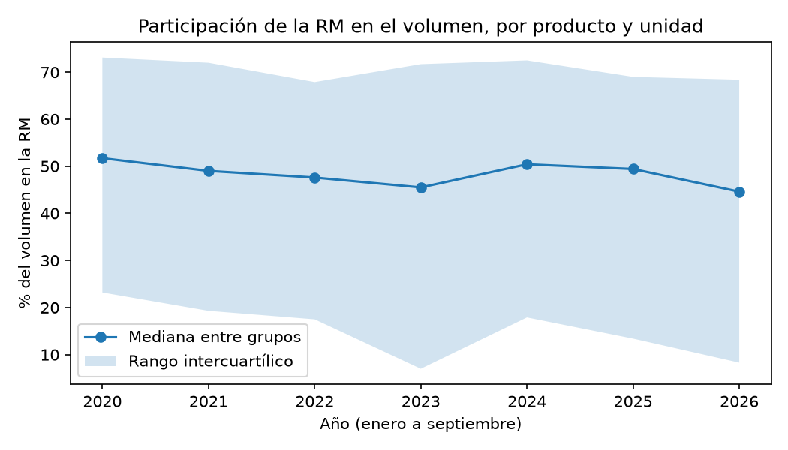
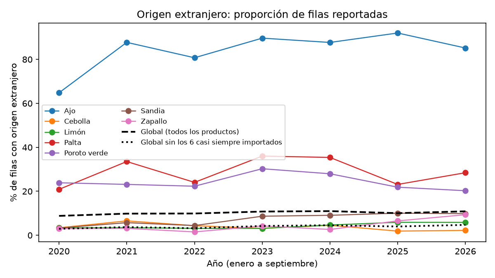
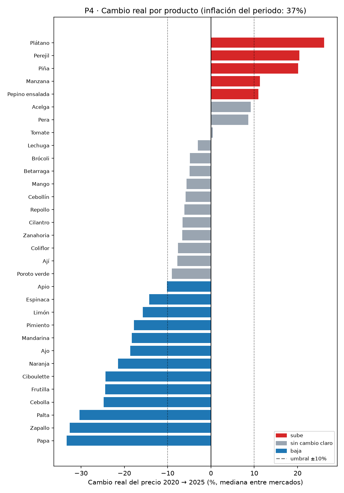
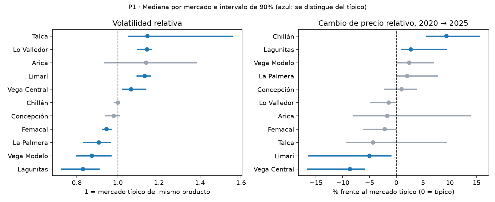
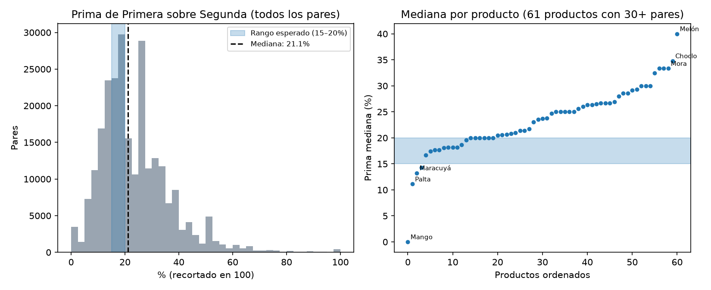
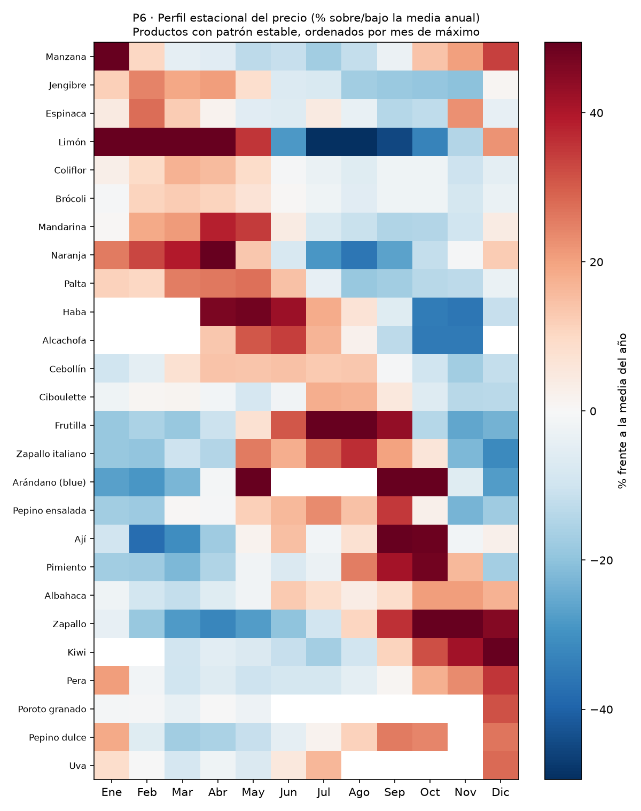

# Precios y volúmenes en los mercados mayoristas de frutas y hortalizas de Chile (2020–2026)

Análisis exploratorio de los registros de comercialización de frutas y hortalizas en mercados mayoristas de Chile, con datos de ODEPA. Se limpian y auditan los datos (incluyendo unidades de venta no comparables entre sí) y se describen patrones de precio, volumen, origen y mercado con Python, SQL y un dashboard en Power BI. Se describen asociaciones y diferencias observadas, no causalidad.

> 🚧 **Proyecto en construcción.** Última actualización: 2026-10-18

## Estado

- [x] Estructura del repositorio y documentación de los datos
- [x] Carga y auditoría de datos
- [x] Limpieza
- [x] Análisis de volúmenes, origen, precios, estacionalidad e inflación (P1 a P6)
- [x] Conclusiones (notebook 06)
- [x] Base de datos SQL
- [ ] Dashboard e informe

## Preguntas de investigación

| # | Pregunta | Resultado esperado | Respuesta |
| --- | --- | --- | --- |
| P1 | Para un mismo producto y unidad, ¿qué mercados muestran mayor variabilidad de precios entre 2020 y 2025, y qué cambio acumulado tuvieron? | Los mercados grandes fluctúan más | Cuatro mercados más volátiles que el típico (Talca, Lo Valledor, Limarí, Vega Central) y cuatro menos (Femacal, La Palmera, Vega Modelo, Lagunitas); el tamaño no se asocia con la volatilidad. En cambio acumulado solo se distinguen Vega Central (−8,6%), Limarí (−5,0%) y Lagunitas (+2,7%) |
| P2 | Dentro de cada producto, ¿qué proporción del volumen se registra en mercados de la Región Metropolitana, y cambió entre 2020 y 2026? | Entre 40% y 55%, con tendencia al alza | Entre 44% y 60% según la medida, sin tendencia clara: el producto típico baja (54% → 47%), el total de kilos no (55% → 57%) |
| P3 | Dentro de cada producto, ¿cómo ha evolucionado la participación del origen extranjero en las filas reportadas entre 2020 y 2026? | Entre 12% y 18%, con leve alza | 8,8% → 10,9% de las filas, sin un giro general: sube en sandía, zapallo y limón, y no muestra tendencia en palta, poroto verde ni cebolla |
| P4 | ¿Cuánto del cambio nominal de precios entre 2020 y 2025 corresponde a inflación general, y qué productos subieron o bajaron en términos reales? | — | El IPC subió 36,9% y el producto mediano 26,8% (−7,1% real; negativo también con bases en 2021 y 2022). Con la base 2020 suben en términos reales plátano, piña, perejil, manzana y pepino ensalada y bajan trece productos, pero esa clasificación depende del año base: solo la piña sube con las tres bases probadas |
| P5 | Dentro de un mismo producto y unidad, ¿la calidad reportada se asocia con diferencias de precio, y de qué magnitud? | Prima de 15–20% en la mayoría de los casos | Prima mediana de 21,1% de Primera sobre Segunda (de 11% a 40% según el producto); Primera es más cara en el 98,3% de los pares |
| P6 | ¿Qué productos muestran un patrón estacional estable, con los mismos meses de precio alto y bajo en años distintos? | — | 26 de 44 productos evaluables tienen un patrón estacional estable (16 fuerte): Limón, Frutilla, Arándano, Manzana y Naranja entre otros. Tomate, cebolla y papa, tres de los más transados, no muestran un patrón estable |
| P7 *(opcional)* | Si se ajusta una tendencia simple con 2020–2024, ¿cuánto se acerca a lo observado en 2025, frente a repetir el valor del mismo mes del año anterior? | — | No realizada: pregunta opcional, descartada por alcance. Ver D-34 |

Las preguntas pueden ajustarse tras la auditoría de datos. Cualquier cambio o descarte se documenta en [`docs/decisiones.md`](docs/decisiones.md).

## Datos

- **Fuente:** Oficina de Estudios y Políticas Agrarias (ODEPA), conjunto "Precios mayoristas de frutas y hortalizas".
- **Periodo:** enero de 2020 a octubre de 2026 (2026 incompleto).
- **Tamaño:** 1.297.535 filas en 7 archivos CSV.
- **Licencia:** Creative Commons Attribution (CC BY).
- **Detalle, diccionario y supuestos:** [`data/raw/README.md`](data/raw/README.md)

## Hallazgos principales

Los resultados se refieren a los 12 mercados mayoristas que monitorea ODEPA y describen asociaciones, no causas. El detalle y las limitaciones de cada pregunta están en los notebooks 03 a 06.

**1. La RM concentra entre 44% y 60% del volumen monitoreado, sin una tendencia clara (P2).** El producto típico baja de 54% a 47%, pero el total de kilos sube de 55% a 57%, porque los productos de mayor volumen casi no se mueven.



**2. La participación extranjera es de ~10% de las filas reportadas y sube poco (P3).** Seis productos casi siempre importados explican más de la mitad del nivel y cerca de una quinta parte del alza.



**3. Los precios mayoristas subieron menos que la inflación (P4).** Entre 2020 y 2025 el IPC subió 36,9% y el producto mediano 26,8%: un cambio real de −7,1%, que se mantiene negativo con otros años base. Por producto, con la base 2020 cinco suben y trece bajan en términos reales, pero esa clasificación depende del año base: solo la piña sube con las tres bases probadas.



**4. Hay mercados más y menos volátiles, y no depende del tamaño (P1).** Entre los extremos hay unos 37% más de volatilidad.



**5. La calidad se paga: Primera cuesta ~21% más que Segunda (P5).** Con mucha variación entre productos, de 11% (palta) a 40% (melón).



**6. 26 de 44 productos tienen un patrón estacional estable (P6).** Tomate y cebolla no lo tienen.



## Dashboard

*(Capturas al terminar.)*

## Base de datos y consultas SQL

El dataset limpio se carga en una base SQLite de una sola tabla (`precios`, 21 columnas) con una clave única (fecha, mercado, producto, variedad, calidad, unidad, origen), lo que confirma en SQL que no hay filas duplicadas. La base pesa varios cientos de MB, por eso no se versiona: se genera con el script.

```bash
python src/crear_bd.py      # crea data/processed/precios.db (requiere haber ejecutado el notebook 02)
python src/consultas.py     # ejecuta sql/02_consultas_analisis.sql y muestra los resultados
```

| Consulta | Qué calcula | Coincide con |
| --- | --- | --- |
| Q1 | Panorama: filas, productos, mercados, regiones y fechas | Auditoría (notebook 01): 1.297.334 filas, 82 productos, 12 mercados y 9 regiones |
| Q2 | Filas por año | Tabla de archivos de `data/raw/README.md` (2025 con 201 filas menos, las excluidas en la limpieza) |
| Q3 | Filas por región | La RM concentra el 38,9% de las filas (notebook 02) |
| Q4 | Participación extranjera por año (enero a septiembre), global y sin seis productos casi siempre importados | P3 (notebook 03): 8,81% → 10,89% y 2,95% → 4,72% |
| Q5 | Precio ponderado por volumen frente al simple, tomate en bandeja de 18 kilos | El promedio simple sobreestima el precio entre 3,6% y 7,7% |

## Estructura del repositorio

```text
chile-wholesale-produce-analysis/
├── README.md
├── data/
│   ├── raw/           # CSV originales de ODEPA (no se modifican)
│   ├── external/      # IPC del INE (armado a mano y serie empalmada)
│   ├── interim/       # datos intermedios (generados, no versionados)
│   └── processed/     # dataset limpio y base SQLite (generados, no versionados)
├── docs/
│   └── decisiones.md  # bitácora de decisiones de limpieza y análisis
├── notebooks/         # 01 a 06, en orden de ejecución
├── src/               # funciones reutilizables, creación de la base SQLite y consultas
├── sql/               # creación de tablas y consultas
├── dashboard/         # archivo de Power BI y capturas
├── reports/           # informe, resumen ejecutivo y presentación
└── images/            # gráficos usados en este README
```

## Herramientas

Python, Pandas, Matplotlib, Seaborn, SQLite, Power BI, Jupyter, Git.

## Cómo reproducirlo

Probado con Python 3.12 en Windows.

```bash
git clone https://github.com/hugonzalezc/chile-wholesale-produce-analysis.git
cd chile-wholesale-produce-analysis
python -m venv .venv
# Windows: .venv\Scripts\Activate.ps1   |   macOS/Linux: source .venv/bin/activate
pip install -r requirements.txt
```

Los CSV crudos ya están en `data/raw/`. Ejecuta los notebooks en este orden, **desde la carpeta `notebooks/`** (las rutas son relativas):

| Orden | Notebook | Qué hace | Salida |
| --- | --- | --- | --- |
| 1 (opcional) | `01_carga_y_auditoria.ipynb` | Diagnóstico de los datos crudos | Solo lectura |
| 2 | `02_limpieza.ipynb` | Limpia y genera el dataset | `data/processed/precios_limpio.parquet` |
| 3 | `03_eda_volumenes.ipynb` | P2 y P3 | `images/` |
| 4 | `04_analisis_precios.ipynb` | Validación del precio por kilo, P1 y P5 | `images/` |
| 5 | `05_analisis_temporal.ipynb` | P6 y P4 (usa `data/external/ipc_ine.csv`) | `images/` |
| 6 | `06_conclusiones.ipynb` | Conclusiones (solo texto) | — |

El notebook 01 carga todo como texto y usa más de 1 GB de memoria; el 02 no lo necesita. El 04 tarda varios minutos. Los remuestreos usan semilla fija, así que los resultados se reproducen.

**Opcional (SQL):** después del notebook 02, ejecuta `python src/crear_bd.py` y `python src/consultas.py` (ver la sección "Base de datos y consultas SQL").

Para ejecutarlos sin abrir Jupyter:

```bash
cd notebooks
for n in 02_limpieza 03_eda_volumenes 04_analisis_precios 05_analisis_temporal 06_conclusiones; do
  jupyter nbconvert --to notebook --execute --inplace "$n.ipynb"
done
```

## Limitaciones

- La unidad de `Volumen` no está especificada por la fuente; se trabaja con una hipótesis (D-14), pendiente de confirmar con ODEPA.
- Los volúmenes no se suman entre productos. Entre etiquetas de un mismo producto solo se suman en kilos, bajo esa hipótesis.
- Solo se cubren los mercados que ODEPA monitorea, no todo el comercio del país.
- 2026 es un año incompleto; las comparaciones anuales usan los mismos meses.
- Los precios son nominales, salvo en P4, donde se deflactan con el IPC general del INE, un índice de hogares urbanos y no de alimentos.
- P6 evalúa 44 de los 82 productos.
- Los resultados describen asociaciones, no relaciones causales.
- La clasificación de P4 por producto depende del año base (D-33).

## Fuente y atribución

Datos: ODEPA, [Portal de Datos Abiertos](https://datos.odepa.gob.cl/), licencia CC BY.

_Proyecto desarrollado con asistencia de Claude (Anthropic) para la escritura de código y la redacción. Las decisiones de diseño, la verificación de resultados y las conclusiones fueron revisadas por mí._